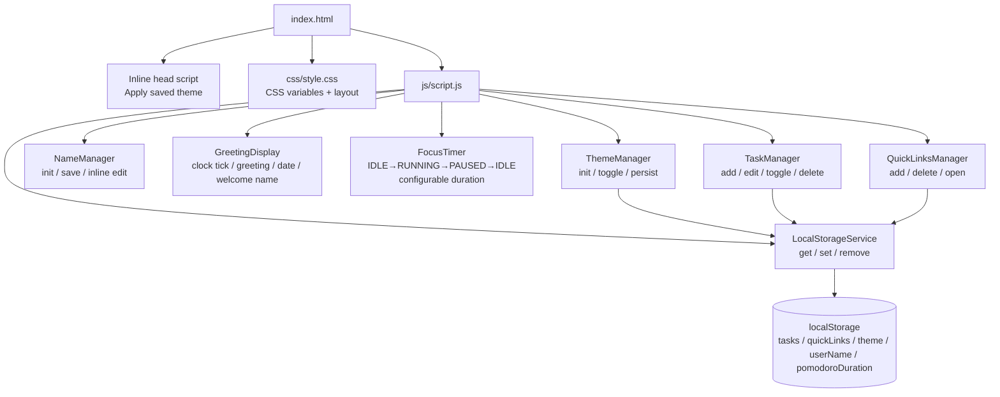

# Design Document

## Overview

The To-Do List Life Dashboard is a single-page static web application built with vanilla HTML, CSS, and JavaScript. It runs entirely in the browser with no backend, no build step, and no external frameworks.

The application provides five user-facing features on one page: a real-time clock and time-based greeting with a personalized welcome name, a Pomodoro focus timer with configurable duration, a to-do list with full CRUD, a quick-links panel, and a light/dark theme toggle. All features co-exist in a single `index.html`, one `css/style.css`, and one `js/script.js`.

Persistent user data — Tasks, Quick Links, and Theme preferences — is stored in the browser's `localStorage` API. The clock is derived from system time on each tick, and the Focus Timer always resets to 25:00 on page refresh.

The design goal is simplicity: each component is an isolated module within the single JS file, communicating through shared state functions rather than a framework or event bus. This keeps the code learnable and directly matches the Coding Camp assignment constraints.

## Architecture

The application follows a **component-per-concern** pattern inside a single JavaScript file. There is no module bundler; instead, the file is organized into clearly delimited sections using comments.

```
index.html
├── <head>
│   └── <script> (inline, runs before body renders — applies saved theme)
├── <link rel="stylesheet" href="css/style.css">
└── <body>
    ├── Header: clock, date, greeting, theme toggle
    ├── Main Grid
    │   ├── Focus Timer card
    │   └── Task Manager card
    ├── Quick Links card
    └── <script src="js/script.js">

css/style.css
└── CSS custom properties, layout, component styles, responsive breakpoints

js/script.js
├── LocalStorageService   — getJSON/setJSON for Tasks & Links; getRaw/setRaw for Theme, Name, Duration
├── ThemeManager          — theme read/write, toggle, CSS variable swap
├── NameManager           — custom name read/write, inline edit mode
├── GreetingDisplay       — clock tick, date format, greeting text, welcome name display
├── FocusTimer            — countdown state machine, configurable duration, interval management
├── TaskManager           — task CRUD, render, localStorage sync
└── QuickLinksManager     — link CRUD, URL validation, render, localStorage sync
```

**Theme flash prevention**: A tiny inline `<script>` in `<head>` reads the saved theme key from `localStorage` and sets `document.documentElement.setAttribute('data-theme', ...)` before the browser paints. This eliminates the light-to-dark flicker on load.

**Rendering model**: Each manager owns a `render()` function that rebuilds its DOM section from its in-memory array. `render()` is called after every mutation. There is no virtual DOM or diffing; the lists are small enough that full re-render is instant.

### DOM Rendering Safety

User-provided content (task text, link names, URLs) is inserted into the DOM safely:

- All task and link elements are built with `document.createElement()` — never by concatenating HTML strings into `innerHTML`
- User-provided text (task descriptions, link display names) is assigned via `.textContent`, which the browser treats as plain text and never executes as markup
- Link `href` attributes are only set after the URL has passed `isValidUrl()` — raw user input is never assigned directly to `href`

This applies to both `TaskManager.render()` and `QuickLinksManager.render()`.

**Initialization sequence** (DOMContentLoaded):
1. `ThemeManager.init()` — confirm theme attribute (inline script already set it)
2. `NameManager.init()` — restore custom name, wire edit controls
3. `GreetingDisplay.init()` — start clock interval
4. `FocusTimer.init()` — restore saved duration, render initial state
5. `TaskManager.init()` — load tasks from localStorage, render
6. `QuickLinksManager.init()` — load links from localStorage, render

### Architecture Diagram



## Components and Interfaces

### LocalStorageService

Centralized thin wrapper around `localStorage` that handles JSON serialization and parse errors.

```
getJSON(key)        → parses stored JSON string; returns parsed value, or null if key missing or value is corrupt (wraps JSON.parse in try/catch)
setJSON(key, value) → serializes value to JSON string and stores it; wraps localStorage.setItem in try/catch — on QuotaExceededError or other error, logs to console, shows a brief user-visible warning (e.g., a temporary status message) so the user knows the change was not saved, and leaves the application functional; the in-memory array already reflects the mutation but the change will not persist across page refresh and is not automatically rolled back
getRaw(key)         → returns the raw string from localStorage, or null if key is missing (no JSON parsing)
setRaw(key, value)  → stores raw string directly; wraps localStorage.setItem in try/catch — on failure, logs to console, shows a brief user-visible warning, and leaves the application functional; the current-session behavior is unaffected but the preference will not be restored on next load
removeItem(key)     → void
```

Usage mapping:
- Tasks → `getJSON("tasks")` / `setJSON("tasks", tasks)`
- Quick Links → `getJSON("quickLinks")` / `setJSON("quickLinks", links)`
- Theme → `getRaw("theme")` / `setRaw("theme", theme)`
- Custom Name → `getRaw("userName")` / `setRaw("userName", name)`
- Pomodoro Duration → `getRaw("pomodoroDuration")` / `setRaw("pomodoroDuration", minutes)`

Keys used across the application:
- `"tasks"` — JSON array of Task objects
- `"quickLinks"` — JSON array of Link objects
- `"theme"` — `"dark"` | `"light"`
- `"userName"` — custom display name string; absent means no name configured
- `"pomodoroDuration"` — integer string (minutes, 1–120); absent means default 25

### ThemeManager

```
init()    → reads getRaw("theme") (defaults "dark"), sets data-theme on <html>
toggle()  → switches between "dark" and "light", calls setRaw("theme", theme), updates toggle button icon
getTheme() → "dark" | "light"
```

The theme is applied via a `data-theme` attribute on `<html>`. CSS rules under `[data-theme="light"]` override the default dark-mode custom properties.

### generateId (Utility)

Shared by `TaskManager` and `QuickLinksManager` to produce unique IDs for new items.

```
generateId() → string
  - Uses crypto.randomUUID() when available (modern browsers)
  - Falls back to Date.now().toString() + Math.random().toString(36).slice(2) otherwise
```

Using `crypto.randomUUID()` eliminates the collision risk that exists when multiple items are added in rapid succession (which `Date.now()` alone does not prevent).

### NameManager

```
init()    → reads getRaw("userName"), renders welcome message, wires edit/save/cancel buttons
getName() → returns current custom name string (empty string if none set)

Internal:
  _render()       → updates #welcome-name element: "Welcome, [name]!" or "Welcome!" if name is empty
  _enterEditMode() → reveals #name-edit-area, hides #edit-name-btn, populates input with current name
  _exitEditMode()  → hides #name-edit-area, shows #edit-name-btn, clears input error state
  _save()         → trims input; on empty: shows red border and returns; otherwise saves to localStorage, calls _render(), _exitEditMode()
```

The name is displayed using `.textContent` — raw user input is never assigned via `innerHTML`.

### GreetingDisplay

```
init()         → calls tick() immediately, starts setInterval(tick, 1000)
tick()         → reads new Date(), updates time display, date display, greeting text
getGreeting(hour: number) → "Good Morning" | "Good Afternoon" | "Good Evening"
formatTime(date: Date)    → "HH:MM" string (24-hour with leading zero)
formatDate(date: Date)    → "Weekday, Day Month Year" string
```

Time-period boundaries:
- Morning: hour 0–11
- Afternoon: hour 12–17
- Evening: hour 18–23

### FocusTimer

State machine with four transitions:

```
IDLE    --[start]--> RUNNING
RUNNING --[stop]---> PAUSED
PAUSED  --[start]--> RUNNING
RUNNING --[tick reaches 0]--> IDLE
* --[reset]--> IDLE
```

```
init()    → restore _selectedDuration from localStorage ("pomodoroDuration", default 25 min), populate duration input, then call reset()

start() when state is IDLE or PAUSED:
  - snapshot startRemaining = remaining (accurate value, saved by stop() if resuming)
  - snapshot startTimestamp = Date.now()  ← fresh baseline for this session
  - set state = RUNNING
  - begin setInterval(countdown, 500)

stop():
  - elapsed = Math.floor((Date.now() - startTimestamp) / 1000)
  - remaining = Math.max(0, startRemaining - elapsed)   ← recalculate at this exact moment
  - clearInterval
  - state = PAUSED
  - render()

reset()          → clearInterval, state=IDLE, remaining=_selectedDuration, render
countdown()      → recalculate remaining from timestamp; if remaining <= 0: stop countdown, state=IDLE; render
applyDuration()  → blocked when RUNNING (shows inline error); validates input (1–120 integer); sets _selectedDuration = input*60; persists to localStorage; calls reset()
formatDisplay(seconds: number) → "MM:SS" string
```

The timer does not persist the active countdown state to localStorage — a page refresh always resets to the saved `_selectedDuration`.

### TaskManager

```
init()                      → load tasks from localStorage, render
addTask(text: string)       → validate non-empty, create Task, push, persist, render
editTask(id, newText)       → validate non-empty, update text, persist, render
toggleTask(id)              → flip completed boolean, persist, render
deleteTask(id)              → remove from array, persist, render
persist()                   → LocalStorageService.setJSON("tasks", tasks)
render()                    → rebuild task list DOM from tasks array

init() detail:
  - raw = getJSON("tasks")
  - items = Array.isArray(raw) ? raw : []
  - filter items with isValidTask() before assigning to the in-memory array
  - render

isValidTask(item) → boolean
  - item.id must be a non-empty string
  - item.text must be a non-empty string
  - item.completed must be a boolean
  - item.createdAt must be a non-empty string
  - returns false if any field fails
```

### QuickLinksManager

```
init()                       → load links from localStorage, render
addLink(name, url)           → validate name non-empty, trim url, validate via isValidUrl(trimmedUrl), create Link storing new URL(trimmedUrl).href as url, push, persist, render
deleteLink(id)               → remove from array, persist, render
openLink(url)                → window.open(url, "_blank", "noopener,noreferrer")

isValidUrl(url: string) → boolean
  - Trim the input string
  - Attempt new URL(trimmedUrl)
  - Returns false if constructor throws (malformed URL)
  - Returns false if protocol is not "http:" or "https:"
  - Returns false if hostname is empty or whitespace-only
  - Returns true otherwise

  Example outcomes:
  Invalid:
  - https:// → rejected (no hostname)
  - ftp://example.com → rejected (wrong protocol)
  - javascript:alert(1) → rejected (wrong protocol)
  - //example.com → rejected (constructor throws — no protocol)
  Valid:
  - https://example.com → accepted, stored as https://example.com/ (normalized by URL constructor)

persist()                    → LocalStorageService.setJSON("quickLinks", links)
render()                     → rebuild links DOM from links array

init() detail:
  - raw = getJSON("quickLinks")
  - items = Array.isArray(raw) ? raw : []
  - filter items with isValidLink() before assigning to the in-memory array
  - render

isValidLink(item) → boolean
  - item.id must be a non-empty string
  - item.name must be a non-empty string
  - item.url must pass isValidUrl()
  - returns false if any field fails
```

## Data Models

### Task

```json
{
  "id":        "string  — generated by generateId() at creation time",
  "text":      "string  — user-entered description, non-empty",
  "completed": "boolean — false on creation",
  "createdAt": "string  — ISO 8601 timestamp"
}
```

### Link

```json
{
  "id":        "string — generated by generateId() at creation time",
  "name":      "string — user-entered display name, non-empty",
  "url":       "string — normalized via new URL(trimmedInput).href, guaranteed http: or https: protocol",
  "createdAt": "string — ISO 8601 timestamp (implementation adds this field; not validated by isValidLink)"
}
```

> **Note:** The implementation stores an additional `createdAt` field on each Link object (set to `new Date().toISOString()` at creation time). This field is not required by any requirement and is not checked by `isValidLink()`, so it is non-breaking — existing stored links without `createdAt` continue to load correctly.

### Theme Preference

Stored directly as a string value under key `"theme"`:
- `"dark"` (default when key is absent)
- `"light"`

### localStorage Schema

```
localStorage
├── "theme"            → "dark" | "light"
├── "userName"         → custom name string (absent = no name configured)
├── "pomodoroDuration" → integer string in minutes, 1–120 (absent = default 25)
├── "tasks"            → JSON.stringify(Task[])
└── "quickLinks"       → JSON.stringify(Link[])
```

## UI Layout

```
┌─────────────────────────────────────────────────────────────┐
│  HEADER                                                     │
│  [Welcome, Alice!]  [Good Morning]  [14:32]  [Mon, 1 Jan]  │
│                                     [✏ Name]  [🌙 / ☀]    │
│  (name edit area — hidden by default)                       │
├──────────────────────┬──────────────────────────────────────┤
│  FOCUS TIMER         │  TASK MANAGER                        │
│  25:00               │  [ Add task...  ] [+]                │
│  [Start][Stop][Reset]│  Sort: [Active First ▾]              │
│  Duration: [25] [Set]│  ☐ Buy groceries        [✏][🗑]     │
│                      │  ☑ Read chapter          [✏][🗑]    │
├──────────────────────┴──────────────────────────────────────┤
│  QUICK LINKS                                                │
│  [Name] [URL] [Add]                                        │
│  [GitHub] [YouTube]                                        │
└─────────────────────────────────────────────────────────────┘
```

**Responsive breakpoint at 768px**: the two-column main grid collapses to a single column; all cards stack vertically.

## Visual Design — CSS Variables

The two themes are expressed as CSS custom property sets. Dark mode is the default on `:root`; light mode overrides via `[data-theme="light"]`.

```css
:root {
  --bg:         #0B1120;
  --card:       #151F32;
  --surface:    #1D2A40;
  --accent:     #8B9CF6;
  --accent2:    #65C7F7;
  --text:       #F1F5F9;
  --text-muted: #94A3B8;
  --success:    #4ADE80;
  --danger:     #F87171;
  --border:     rgba(148, 163, 184, 0.12);
}

[data-theme="light"] {
  --bg:         #F5F7FB;
  --card:       #FFFFFF;
  --surface:    #EDF2FA;
  --accent:     #6578DB;
  --accent2:    #38A9DB;
  --text:       #172033;
  --text-muted: #64748B;
  --success:    #22C55E;
  --danger:     #EF4444;
  --border:     rgba(23, 32, 51, 0.10);
}
```

Color transitions on theme switch use `transition: background-color 0.3s ease, color 0.3s ease, border-color 0.3s ease` applied globally so all cards, text, and borders animate smoothly.


## Correctness Properties

*A property is a characteristic or behavior that should hold true across all valid executions of a system — essentially, a formal statement about what the system should do. Properties serve as the bridge between human-readable specifications and machine-verifiable correctness guarantees.*

Since this project uses vanilla JavaScript with no test framework mandated by the assignment, the properties below are written as universally quantified invariants. They guide manual testing, code review, and can be verified with any lightweight testing approach the developer chooses.

### Property 1: Time format correctness

*For any* `Date` object passed to `formatTime()`, the returned string SHALL match the pattern `HH:MM` where HH is a zero-padded hour (00–23) and MM is a zero-padded minute (00–59).

**Validates: Requirements 1.1**

### Property 2: Date format completeness

*For any* `Date` object passed to `formatDate()`, the returned string SHALL contain the full four-digit year, a human-readable month name or abbreviation, and the day-of-month number.

**Validates: Requirements 1.3**

### Property 3: Greeting correctness across all hours

*For any* integer hour in the range 0–23 passed to `getGreeting()`:
- Hours 0–11 SHALL return exactly `"Good Morning"`
- Hours 12–17 SHALL return exactly `"Good Afternoon"`
- Hours 18–23 SHALL return exactly `"Good Evening"`

Every valid hour maps to exactly one greeting; no hour is unhandled.

**Validates: Requirements 2.1, 2.2, 2.3**

### Property 4: Timer stop preserves remaining time

*For any* running timer, calling `stop()` SHALL set `remaining` to `Math.max(0, startRemaining - Math.floor((Date.now() - startTimestamp) / 1000))` — the exact elapsed seconds recalculated at the moment `stop()` is invoked — and set state to `PAUSED`. The preserved `remaining` value SHALL be used as the baseline when `start()` is called again.

**Validates: Requirements 3.3**

### Property 5: Timer stops at zero

*For any* countdown sequence that reaches `remaining === 0`, the timer SHALL stop (state transitions to IDLE, interval is cleared), and `remaining` SHALL NOT decrement below zero.

**Validates: Requirements 3.6**

### Property 6: Whitespace input is always rejected

*For any* string composed entirely of whitespace characters (including the empty string), calling `addTask()` or `editTask()` with that string SHALL leave the tasks array unchanged.

**Validates: Requirements 4.2, 5.3**

### Property 7: Task addition round-trip

*For any* non-empty task description string `text`, after calling `addTask(text)`:
1. The tasks array SHALL contain exactly one new task with `text` equal to the input
2. `LocalStorageService.getJSON("tasks")` SHALL contain a task with `text` equal to the input

**Validates: Requirements 4.1, 4.4**

### Property 8: Task edit round-trip

*For any* existing task identified by `id` and any non-empty string `newText`, after calling `editTask(id, newText)`:
1. The task in the array with that `id` SHALL have `text === newText`
2. `LocalStorageService.getJSON("tasks")` SHALL reflect `newText` for that task

**Validates: Requirements 5.2, 5.4**

### Property 9: Completion toggle is a round-trip

*For any* task with initial `completed` value `C`, calling `toggleTask(id)` twice SHALL return `completed` to `C`, and localStorage SHALL reflect the final value after each call.

**Validates: Requirements 6.1, 6.3, 6.4**

### Property 10: Task deletion is permanent

*For any* task in the list identified by `id`, after calling `deleteTask(id)`:
1. No task with that `id` SHALL remain in the tasks array
2. `LocalStorageService.getJSON("tasks")` SHALL NOT contain a task with that `id`

**Validates: Requirements 7.1, 7.2**

### Property 11: Task JSON round-trip

*For any* valid Task object `{ id, text, completed, createdAt }`, `JSON.parse(JSON.stringify(task))` SHALL produce an object where `id`, `text`, `completed`, and `createdAt` are equal to the originals.

**Validates: Requirements 8.4**

### Property 12: URL validation correctness

*For any* URL string that does NOT begin with `http://` or `https://` (after trimming), or that has an empty hostname, `isValidUrl()` SHALL return `false` and `addLink()` SHALL reject the submission.

*For any* URL string that, after trimming, is accepted by `isValidUrl()` (valid `http:` or `https:` protocol, non-empty hostname), and has a non-empty display name, `addLink()` SHALL create a new Link with the URL stored in normalized form (`new URL(trimmedUrl).href`).

**Validates: Requirements 9.2, 9.3**

### Property 13: Link JSON round-trip

*For any* valid Link object `{ id, name, url }`, `JSON.parse(JSON.stringify(link))` SHALL produce an object where `id`, `name`, and `url` are equal to the originals.

**Validates: Requirements 10.4**

### Property 14: Theme toggle is a round-trip

*For any* initial theme `T` in `{ "dark", "light" }`, calling `toggle()` twice SHALL result in `getTheme() === T` and `localStorage.getItem("theme") === T`.

**Validates: Requirements 16.2, 16.6**

## Error Handling

### Input Validation Errors

All validation errors are **silent rejections with inline user feedback** — no alert dialogs, no console errors exposed to the user.

| Scenario | Handling |
|---|---|
| Empty/whitespace task text on add | Input border turns red briefly; task is not added |
| Empty/whitespace task text on edit | Input border turns red; original text is restored on blur/cancel |
| Empty name or URL on link add | Relevant field border turns red; link is not added |
| URL missing http/https protocol | URL field border turns red; link is not added |

### localStorage Errors

`LocalStorageService.getJSON()` wraps `JSON.parse` in a try/catch. If the stored value is corrupt (e.g., manually tampered), it returns `null`, which causes the calling manager to initialize with an empty array. This prevents a parse error from crashing the application.

`LocalStorageService.setJSON()` wraps `localStorage.setItem()` in a try/catch. On `QuotaExceededError` or any other storage error, the error is logged to the console. The in-memory array already reflects the latest mutation at this point — the change IS visible in the UI for the current session — but it will NOT persist across a page refresh. A brief user-visible warning (e.g., a temporary status message) is shown so the user knows the change was not saved. The application remains functional and the in-memory mutation is not automatically rolled back.

`LocalStorageService.setRaw()` (used by `ThemeManager`) similarly wraps `localStorage.setItem()` in a try/catch. On failure, the theme toggle still works visually for the current session because the `data-theme` attribute is already applied to `<html>`, but the preference will not be restored on next load. A brief user-visible warning is shown to inform the user that the theme preference could not be saved.

### Timer Edge Cases

- Calling `start()` on a RUNNING timer is a no-op (guard against double-start).
- Calling `stop()` on an IDLE timer is a no-op.
- `remaining` is clamped to `>= 0`; the countdown interval is cleared before `remaining` can go negative.

### Theme Load Edge Case

If `localStorage.getItem("theme")` returns any value other than `"dark"` or `"light"` (e.g., corrupt data), the application defaults to `"dark"`. The inline head script uses a guarded assignment:

```js
const t = localStorage.getItem('theme');
document.documentElement.setAttribute('data-theme', t === 'light' ? 'light' : 'dark');
```

## Testing Strategy

### Overview

Since the assignment mandates vanilla JS with no test framework, the testing strategy is split into:

1. **Manual verification checklist** — step-by-step scenarios that cover all acceptance criteria
2. **Informal property checks** — devtools console snippets that verify the correctness properties above

If the developer chooses to add a lightweight test runner (e.g., copying `qunit` or writing a minimal assertion harness), the properties in this document map directly to test cases.

### Unit Testing Approach (Manual / Console)

Each pure function should be verified individually in the browser console before integration:

| Function | Test approach |
|---|---|
| `formatTime(date)` | Pass dates with hours 0, 9, 12, 23 and minutes 0, 5, 59; verify output format |
| `formatDate(date)` | Pass a known date; verify day name, month, year appear in output |
| `getGreeting(hour)` | Loop hours 0–23 in console; verify correct string for each boundary |
| `isValidUrl(url)` | Invalid: `""`, `"ftp://example.com"`, `"javascript:alert(1)"`, `"//example.com"`, `"https://"` (no hostname). Valid: `"https://example.com"` (accepted, normalizes to `"https://example.com/"`) |
| `FocusTimer.formatDisplay(seconds)` | Test 0, 1, 59, 60, 1500, 1499 |
| `LocalStorageService.getJSON` with corrupt data | Set a key to `"not json"`, verify null return without throw |

### Integration Testing (Manual Browser Walkthrough)

Covers all acceptance criteria in requirements.md:

**Greeting Display**
- [ ] Clock shows correct time and updates every second
- [ ] Date shows day name, day, month, year
- [ ] At hour boundary (11→12, 17→18, 23→0), greeting updates within 1 second

**Focus Timer**
- [ ] Loads at 25:00
- [ ] Start → timer counts down, display updates every second
- [ ] Stop → countdown pauses, remaining time preserved
- [ ] Start again → resumes from paused value
- [ ] Reset from any state → returns to 25:00
- [ ] Countdown reaching 00:00 → timer stops automatically

**Task Manager**
- [ ] Add task → appears in list, persists across page refresh
- [ ] Add empty/whitespace → rejected, list unchanged
- [ ] Edit task → updates text, persists
- [ ] Edit to empty/whitespace → rejected, original text restored
- [ ] Check/uncheck task → completion state toggles, persists
- [ ] Delete task → removed from list, removed from localStorage

**Quick Links**
- [ ] Add link with valid name + https URL → appears, persists
- [ ] Add with empty name or empty URL → rejected
- [ ] Add with non-http/https URL (e.g., `ftp://example.com`) → rejected
- [ ] Add URL with leading/trailing whitespace → trimmed and accepted if otherwise valid
- [ ] Click link → opens in new tab
- [ ] Delete link → removed from list and localStorage

**Theme**
- [ ] Dark mode is default on first load (no saved preference)
- [ ] Toggle → switches to light, moon/sun icon updates, all colors change smoothly
- [ ] Toggle again → returns to dark
- [ ] Refresh → saved theme is restored before paint (no flash)

**Responsive Layout**
- [ ] At ≥768px: Focus Timer and Task Manager side by side
- [ ] At <768px: all cards stack vertically
- [ ] All text remains readable in both themes at all breakpoints

### Property-Based Testing Guidance

The 14 correctness properties above are written to be directly translatable into automated tests if a test harness is added later. Each property represents a universally quantified invariant that should hold for many randomized inputs, not just the hand-picked examples in the integration checklist.

**Key properties for priority coverage:**
- Property 3 (greeting for all 24 hours) — covers 24 specific inputs; easy to verify exhaustively
- Property 11 (task JSON round-trip) — covers serialization correctness
- Property 13 (link JSON round-trip) — covers serialization correctness
- Property 6 (whitespace rejection) — test with `""`, `" "`, `"\t"`, `"\n"`, `"   "`
- Property 12 (URL validation) — invalid: `ftp://example.com`, `javascript:alert(1)`, `//example.com`, `https://` (no hostname); valid: `https://example.com` (normalizes to `https://example.com/`)

If using a property-based testing library in the future, tag each test with:
**Feature: todo-list-life-dashboard, Property {number}: {property_text}**


### TaskManager — Duplicate Prevention

- Before adding a task, compare its trimmed description against all existing task descriptions using case-insensitive comparison.
- Reject duplicate descriptions and show inline validation feedback.
- Apply the same validation when editing tasks.
- Exclude the task currently being edited from duplicate comparison.
- Rejected duplicate operations must not modify the task array or Local Storage.

### TaskManager — Task Sorting

Supported sort modes:

- Active First: incomplete tasks appear before completed tasks.
- Completed First: completed tasks appear before incomplete tasks.
- Alphabetical: task descriptions are sorted A–Z, case-insensitively.

Implementation rules:

- Default sort order: Active First.
- Provide a sorting dropdown in the Task Manager UI.
- Apply the selected sorting mode whenever the task list renders.
- Sort a copied array using [...tasks].
- Never mutate the original tasks array or Local Storage ordering.

### FocusTimer — Stop Guard

stop() must only execute when state === RUNNING.

If state is IDLE or PAUSED, stop() must be a no-op.

When stopping a running timer, recalculate the remaining time from the current timestamp before transitioning to PAUSED.

